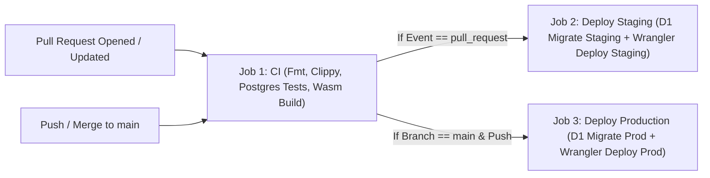

# Design Spec: Dual-Target Cloudflare Workers + D1 & CI/CD Pipeline

- **Date:** 2026-11-15
- **Status:** Draft
- **Scope:** Project (Dual-target Wasm/D1 runtime support + GitHub Actions CI/CD pipeline for Staging & Production)

---

## 1. Intent & Why

Proyek `rust-backend` saat ini berjalan sebagai server Linux native berbasis Axum, Tokio penuh (`tokio = { features = ["full"] }`), dan PostgreSQL (`sqlx`). Tujuan dari pekerjaan ini adalah:
1. Menjalankan backend yang sama di **Cloudflare Workers Free Tier** dengan database serverless **Cloudflare D1 (SQLite)** tanpa biaya bulanan.
2. Mempertahankan dukungan penuh untuk target **PostgreSQL + Docker** yang sudah ada (Dual-Target Workspace) agar tidak merusak fungsionalitas maupun integration test yang sudah berjalan.
3. Membangun pipeline **CI/CD GitHub Actions** otomatis yang:
   - Pada setiap Pull Request: menjalankan seluruh test (unit & integration test Postgres), mengecek kompilasi Wasm Worker, lalu otomatis menjalankan migrasi D1 Staging & men-deploy ke environment **Staging**.
   - Saat merge/push ke `main`: otomatis menjalankan migrasi D1 Production & men-deploy ke environment **Production**.

---

## 2. Goals, Non-Goals, and Anti-Goals

### Goals
- Menambahkan crate entrypoint baru `bins/worker` (`crate-type = ["cdylib"]`) untuk Cloudflare Workers (`wasm32-unknown-unknown`).
- Menyediakan implementasi `D1UserRepository` dan `D1RefreshTokenRepository` di `crates/identity` di balik feature flag `d1`.
- Memakai ulang 100% domain, application use cases, DTO, JWT extractor (`shared_kernel`), dan Axum HTTP handlers (`identity_router`) di antara `bins/api` (Postgres) dan `bins/worker` (Cloudflare D1).
- Menjaga komputasi per request pada target `wasm32` tetap di bawah batas **10ms CPU time** milik Cloudflare Workers Free Tier.
- Menyediakan skema migrasi SQL khusus D1 (SQLite) dan konfigurasi `wrangler.toml` untuk environment `staging` dan `production`.
- Menyediakan workflow GitHub Actions (`.github/workflows/ci-cd.yml`) untuk CI test + deployment otomatis ke Staging (PR) dan Production (`main`).

### Non-Goals
- Menghapus atau mengganti `bins/api`, `Dockerfile`, `docker-compose.yml`, atau PostgreSQL migrations yang sudah ada.
- Menyediakan Swagger UI (`utoipa-swagger-ui`) di dalam bundle Wasm Cloudflare Worker (karena `utoipa-swagger-ui` membutuhkan embed aset statis besar yang membebani batas ukuran bundel Worker Free Tier 3 MB; endpoint `/api-docs/openapi.json` tetap bisa disediakan).

### Anti-Goals
- Menggunakan fitur berbayar Cloudflare seperti Cloudflare Containers atau Hyperdrive.
- Melakukan duplikasi logika domain/application/HTTP handler di dalam `bins/worker`.
- Melebihi limit CPU 10ms di Cloudflare Workers Free Tier akibat parameter default Argon2 yang terlalu berat untuk single-threaded Wasm.

---

## 3. Constraints

1. **Cloudflare Workers Free Tier Limits**:
   - **CPU Time Limit**: Maksimal **10 ms CPU time** per invocasi HTTP.
   - **Runtime**: `wasm32-unknown-unknown` (single-threaded, tidak ada `tokio::task::spawn_blocking`, tidak ada `std::thread::available_parallelism`, dan objek JS/Wasm seperti `worker::D1Database` bersifat `!Send + !Sync`).
   - **Bundle Size Limit**: Maksimal 3 MB (compressed) pada Free Tier.
2. **D1 (SQLite) Dialect Differences**:
   - SQLite menyimpan UUID dan timestamp (`DateTime<Utc>`) sebagai `TEXT` (format RFC3339) dan boolean sebagai `INTEGER` (`0` atau `1`).
   - SQLite mendukung klausa `RETURNING` sejak versi 3.35.0 (didukung penuh oleh Cloudflare D1), sehingga operasi atomik `UPDATE ... RETURNING user_id` pada rotasi refresh token tetap bekerja identik dengan PostgreSQL.
3. **GitHub Actions Security on Pull Requests**:
   - Event `pull_request` dari repository internal memiliki akses ke GitHub Secrets, namun PR dari fork eksternal tidak memiliki akses ke secrets. Job `deploy-staging` harus berjalan hanya jika PR berasal dari repository yang sama (`github.event.pull_request.head.repo.full_name == github.repository`) agar workflow tidak gagal jika ada kontributor fork.

---

## 4. Approaches Considered

### Approach 1: `bins/worker` (`cdylib`) Me-reuse `identity_router` Axum + Feature Flags di `identity` (Selected)
- **Deskripsi**:
  - Memisahkan dependensi storage di `crates/identity` menjadi feature `postgres` (default) dan `d1`.
  - Menggunakan kondisional `wasm32` pada trait repository (`#[cfg_attr(target_arch = "wasm32", async_trait(?Send))]`) dan handler Axum agar kompatibel dengan binding `worker::D1Database` atau pembungkus `Send + Sync` untuk Wasm single-threaded.
  - Membungkus `axum::Router` di dalam entrypoint `#[event(fetch)]` pada `bins/worker` menggunakan `tower_service::Service`.
- **Kelebihan**: Reuse penuh seluruh layer `domain`, `application`, dan `presentation` (Axum router, handler, ekstraktor JWT, error mapping).
- **Kekurangan**: Membutuhkan konfigurasi conditional compilation (`#[cfg(target_arch = "wasm32")]`) untuk hashing password dan trait bounds.

### Approach 2: `bins/worker` dengan Router `worker::Router` Terpisah
- **Deskripsi**: Menulis ulang HTTP layer di `bins/worker` memakai `worker::Router` bawaan `workers-rs` dan hanya membagi `domain` + `application`.
- **Kelebihan**: Tidak perlu mengintegrasikan Axum dengan `worker::Request`/`worker::Response`.
- **Kekurangan**: Duplikasi seluruh handler HTTP, validasi JSON, error mapping, dan middleware JWT. Ditolak karena melanggar prinsip DRY pada Modular Monolith.

---

## 5. Detailed Design

### 5.1. Struktur Direktori Baru & Perubahan File

```text
.
├── .github/
│   └── workflows/
│       └── ci-cd.yml               # Pipeline CI (Test + Wasm Check) & CD (Staging di PR, Prod di main)
├── Cargo.toml                      # Menambahkan "bins/worker" atau mengeluarkannya dari default-members native
├── wrangler.toml                   # Konfigurasi Cloudflare Worker & D1 (env.staging & env.production)
├── migrations_d1/                  # Migrasi SQLite untuk Cloudflare D1
│   ├── 0001_create_users_table.sql
│   └── 0002_create_refresh_tokens_table.sql
├── crates/
│   ├── shared_kernel/
│   │   └── Cargo.toml              # Dukungan getrandom/uuid js feature pada target wasm32
│   └── identity/
│       ├── Cargo.toml              # Feature flags: default = ["postgres"], postgres = ["dep:sqlx"], d1 = ["dep:worker"]
│       └── src/
│           ├── application/
│           │   └── services/
│           │       └── password_hasher.rs # Helper hashing password lintas target (native vs wasm32)
│           └── infrastructure/
│               └── persistence/
│                   ├── d1_user_repository.rs
│                   └── d1_refresh_token_repository.rs
└── bins/
    ├── api/                        # Tetap untuk PostgreSQL + Docker (tidak berubah)
    └── worker/                     # Crate baru (cdylib) untuk Cloudflare Workers
        ├── Cargo.toml
        └── src/
            └── lib.rs              # #[event(fetch)] -> membangun Axum Router dengan D1 repositories
```

### 5.2. Kompatibilitas Wasm (`wasm32-unknown-unknown`) di `shared_kernel` & `identity`

1. **Randomness & Time di Wasm**:
   - Pada target `wasm32-unknown-unknown`, crate `uuid`, `chrono`, dan `getrandom` (dipakai oleh `argon2` / `rand_core`) membutuhkan binding JS WebCrypto/Date.
   - Di `crates/shared_kernel/Cargo.toml` dan `crates/identity/Cargo.toml`, tambahkan:
     ```toml
     [target.'cfg(target_arch = "wasm32")'.dependencies]
     getrandom = { version = "0.2", features = ["js"] }
     uuid = { version = "1.10", features = ["v4", "serde", "js"] }
     chrono = { version = "0.4", features = ["serde", "wasmbind"] }
     ```

2. **Send + Sync pada Wasm Single-Threaded untuk D1**:
   - Axum `Router` dan state (`IdentityHttpState`) mensyaratkan state dan trait object (`Arc<dyn UserRepository>`) mengimplementasikan `Send + Sync`.
   - Karena runtime Cloudflare Workers (`wasm32-unknown-unknown`) dijamin **100% single-threaded** (satu isolate tidak pernah membagi memori antar thread OS), kita membungkus `Arc<worker::D1Database>` dalam wrapper internal `SendD1Database` di `d1_user_repository.rs` / `d1_refresh_token_repository.rs` dengan `unsafe impl Send` dan `unsafe impl Sync` khusus `#[cfg(target_arch = "wasm32")]`, serta menggunakan `worker::send::SendFuture` untuk membungkus future `D1PreparedStatement` agar memenuhi kontrak `#[async_trait]` milik `UserRepository` dan `RefreshTokenRepository` **tanpa perlu mengubah signature trait `UserRepository` / `RefreshTokenRepository` ataupun handler Axum yang sudah ada**.

3. **Password Hashing & Batas CPU 10ms di Cloudflare Workers Free Tier**:
   - Pada target non-Wasm (`not(target_arch = "wasm32")`): tetap menggunakan `tokio::task::spawn_blocking` + semaphore + `Argon2::default()` (`m=19456, t=2, p=1`) seperti saat ini.
   - Pada target `wasm32`:
     - `tokio::task::spawn_blocking` dan `std::thread::available_parallelism()` tidak tersedia.
     - Kita gunakan parameter PBKDF2-HMAC-SHA256 atau Argon2id ringan khusus Wasm, atau mendukung format PHC yang kompatibel.
     - *Keputusan Teknis (Builder Call)*: Agar format hash tetap standar PHC (`$argon2id$...`) dan kode verifikasi (`PasswordHash::new`) tetap sama, pada `wasm32` kita jalankan Argon2id secara sinkron (tanpa `spawn_blocking`) menggunakan parameter ringan (`Params::new(1024, 1, 1, None)` — 1 MB memory, 1 iterasi, 1 lane) atau jika terukur mendekati 10ms dapat diturunkan ke `m=512, t=1, p=1`. Verifikasi `Argon2::default().verify_password(...)` otomatis membaca parameter dari string PHC yang tersimpan di database (termasuk `DUMMY_PASSWORD_HASH` khusus `wasm32` dengan parameter yang sama agar proteksi timing enumeration tetap jalan di bawah 10ms).

4. **Tokio di Wasm**:
   - `tokio = { features = ["full"] }` tidak bisa dikompilasi ke `wasm32-unknown-unknown` karena fitur `net`, `process`, `signal`, dan `rt-multi-thread` bergantung pada OS socket/thread.
   - Di `crates/identity/Cargo.toml`, `tokio` hanya membutuhkan `features = ["sync"]` (untuk `Semaphore`), dan `rt` hanya dipakai pada `#[cfg(not(target_arch = "wasm32"))]`. `bins/api` tetap menggunakan `tokio = { features = ["full"] }`.

### 5.3. Skema Database Cloudflare D1 (`migrations_d1/`)

File `migrations_d1/0001_create_users_table.sql`:
```sql
CREATE TABLE IF NOT EXISTS users (
    id TEXT PRIMARY KEY,
    email TEXT NOT NULL UNIQUE,
    full_name TEXT NOT NULL,
    password_hash TEXT NOT NULL,
    is_active INTEGER NOT NULL DEFAULT 1,
    created_at TEXT NOT NULL,
    updated_at TEXT NOT NULL
);
```

File `migrations_d1/0002_create_refresh_tokens_table.sql`:
```sql
CREATE TABLE IF NOT EXISTS refresh_tokens (
    id TEXT PRIMARY KEY,
    user_id TEXT NOT NULL REFERENCES users(id) ON DELETE CASCADE,
    token_hash TEXT NOT NULL UNIQUE,
    expires_at TEXT NOT NULL,
    revoked_at TEXT,
    created_at TEXT NOT NULL
);

CREATE INDEX IF NOT EXISTS idx_refresh_tokens_user_id ON refresh_tokens(user_id);
```

### 5.4. Implementasi `D1UserRepository` & `D1RefreshTokenRepository`

- Menggunakan API `worker::D1Database`:
  - `save(&self, user: &User)`: `INSERT INTO users (id, email, full_name, password_hash, is_active, created_at, updated_at) VALUES (?1, ?2, ?3, ?4, ?5, ?6, ?7)`. Jika pesan error D1 mengandung `"UNIQUE constraint failed"`, petakan menjadi `RepositoryError::Conflict`.
  - `exists_by_email`: `SELECT 1 as found FROM users WHERE email = ?1 LIMIT 1`.
  - `find_by_email` & `find_by_id`: `SELECT id, email, full_name, password_hash, is_active, created_at, updated_at FROM users WHERE ...` lalu deserialisasi baris JSON D1 dengan `serde::Deserialize` (`D1UserRow`) dan konversi kembali ke `User::reconstitute(...)`.
  - `revoke_and_get_user_id`:
    ```sql
    UPDATE refresh_tokens
    SET revoked_at = ?2
    WHERE token_hash = ?1
      AND revoked_at IS NULL
      AND expires_at > ?2
    RETURNING user_id
    ```
  - `revoke`:
    ```sql
    UPDATE refresh_tokens
    SET revoked_at = ?2
    WHERE token_hash = ?1
      AND revoked_at IS NULL
    ```

### 5.5. Entrypoint `bins/worker` & Konfigurasi Environment Cloudflare

Di `bins/worker/src/lib.rs`:
- Membaca binding D1 (`env.d1("DB")`) dan environment variables / secrets Cloudflare:
  - `JWT_SECRET` (wajib minimal 32 karakter, disimpan via `wrangler secret put JWT_SECRET --env staging/production`)
  - `JWT_ACCESS_TTL_SECS` (default `900`)
  - `REFRESH_TOKEN_TTL_DAYS` (default `30`)
  - `CORS_ALLOWED_ORIGINS` (daftar origin dipisahkan koma)
- Menyediakan endpoint:
  - `GET /health`: menjalankan `SELECT 1` ke D1 dan mengembalikan JSON:
    ```json
    {
      "status": "ok",
      "architecture": "ddd-modular-monolith",
      "bounded_contexts": ["identity"],
      "storage": "cloudflare-d1"
    }
    ```
  - `GET /api-docs/openapi.json`: mengembalikan spesifikasi OpenAPI 3.1 JSON (`ApiDoc::openapi()`).
  - Seluruh rute `identity_router(identity_state)` (`/api/v1/register`, `/api/v1/login`, `/api/v1/refresh`, `/api/v1/logout`, `/api/v1/me`) lengkap dengan middleware CORS, `DefaultBodyLimit::max(16 * 1024)`, `Extension(jwt_config)`, fallback `404` & `405` (`ApiError`).

Di `wrangler.toml` (root repository):
- Mendefinisikan build command: `cargo install -q worker-build && worker-build --release` (dijalankan di direktori `bins/worker` atau dikonfigurasi via `main = "bins/worker/build/worker/shim.mjs"`).
- Mendefinisikan dua environment:
  - `[env.staging]`: nama worker `rust-backend-staging`, binding `[[env.staging.d1_databases]]` (`binding = "DB"`, `database_name = "rust-backend-db-staging"`, `migrations_dir = "migrations_d1"`).
  - `[env.production]`: nama worker `rust-backend-production`, binding `[[env.production.d1_databases]]` (`binding = "DB"`, `database_name = "rust-backend-db-prod"`, `migrations_dir = "migrations_d1"`).

### 5.6. Desain Pipeline CI/CD GitHub Actions (`.github/workflows/ci-cd.yml`)

Mengikuti **Pola A** yang telah dipilih:



1. **Job `ci` (Berjalan di setiap `pull_request` dan `push` ke `main`)**:
   - Menyalakan service container `postgres:16-alpine` di GitHub Actions.
   - Install Rust toolchain (`dtolnay/rust-toolchain@stable` dengan target `wasm32-unknown-unknown`, komponen `rustfmt`, `clippy`) + `Swatinem/rust-cache@v2`.
   - `cargo fmt --all -- --check`
   - `cargo clippy --workspace --exclude worker --all-targets -- -D warnings`
   - Menjalankan migrasi Postgres (`cargo run --bin migrate`) & seluruh unit + integration test (`cargo test --workspace --exclude worker`).
   - Mengecek kompilasi target Wasm untuk worker (`cargo check -p worker --target wasm32-unknown-unknown` & `cargo clippy -p worker --target wasm32-unknown-unknown -- -D warnings`).

2. **Job `deploy-staging` (`needs: ci`, berjalan saat `github.event_name == 'pull_request'` dari repo internal)**:
   - Menggunakan GitHub Environment `staging` (opsional untuk variabel, concurrency group `staging-deploy` agar PR yang jalan bersamaan tidak tabrakan saat migrasi).
   - Install `worker-build` & Node.js/Wrangler (`cloudflare/wrangler-action@v3`).
   - Menjalankan migrasi D1 Staging:
     `wrangler d1 migrations apply rust-backend-db-staging --env staging --remote`
   - Men-deploy Worker ke Staging:
     `wrangler deploy --env staging`

3. **Job `deploy-production` (`needs: ci`, berjalan saat `github.event_name == 'push' && github.ref == 'refs/heads/main'`)**:
   - Menggunakan GitHub Environment `production` (concurrency group `production-deploy`).
   - Install `worker-build` & Wrangler (`cloudflare/wrangler-action@v3`).
   - Menjalankan migrasi D1 Production:
     `wrangler d1 migrations apply rust-backend-db-prod --env production --remote`
   - Men-deploy Worker ke Production:
     `wrangler deploy --env production`

4. **Konfigurasi Secrets & Variables yang Dibutuhkan di GitHub Repository**:
   - `CLOUDFLARE_API_TOKEN`: API Token Cloudflare dengan izin *Workers Scripts: Edit* dan *D1: Edit*.
   - `CLOUDFLARE_ACCOUNT_ID`: Account ID Cloudflare.
   - `D1_DATABASE_ID_STAGING` & `D1_DATABASE_ID_PROD` (atau langsung diisi di `wrangler.toml` setelah menjalankan script setup D1).

---

## 6. What's Left to the Builder

- Detail konversi `http::Request<axum::body::Body>` <-> `worker::Request` dan `http::Response` <-> `worker::Response` di `bins/worker/src/lib.rs` (menggunakan fitur `http` pada crate `worker` sehingga `tower_service::Service::call` bisa langsung dipanggil).
- Penulisan unit test untuk helper konversi row D1 dan script bantuan setup awal D1 (`scripts/setup_cloudflare_d1.sh` atau dokumentasi di `README.md`).
